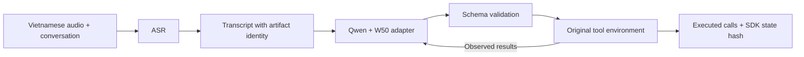

# LifeMate — Vietnamese Voice-to-Action

[](https://github.com/trietnguyeminh/Zalo-AI-2026---Lifemate-Track/actions/workflows/checks.yml)

**An engineering case study in ASR evaluation, tool-use agents, and reliable experiments on limited GPUs.**

[Engineering journal](docs/engineering_journal.md) · [Measured results](docs/results.md) · [Architecture](docs/architecture.md) · [Tiếng Việt](docs/README.vi.md)

LifeMate maps spoken Vietnamese requests to application actions. A useful answer must select the right tools, ground their arguments in available information, and leave the applications in the requested state. Fluent text or valid JSON alone is insufficient.

This is a small public companion to a larger experiment archive for **Zalo AI Challenge 2026, LifeMate track**. It focuses on experiment integration, failure diagnosis, reproducibility, and evidence. Pretrained models and team-provided adapters are credited separately; they were not trained from scratch as part of this public release.

## What the project demonstrates

| Engineering problem | Work and evidence |
|---|---|
| Measure the right objective | Compared WER, action results and latency separately; a lower ASR error rate did not establish a better agent. [Results](docs/results.md) |
| Debug past the headline exception | Traced NumPy import failure to an ABI/path mismatch, and a Safetensors failure to a strided attention mask. [Cases 1–2](docs/engineering_journal.md) |
| Work within GPU limits | Separated DDP replication from pooled memory, added fuller memory probes, and designed overflow-aware checkpoint continuation. [Cases 3–4](docs/engineering_journal.md) |
| Make runs auditable | Pinned base/adapter identities, invalidated incompatible caches, and reconciled executed calls with an append-only ledger. [Runnable examples](src/lifemate_portfolio) |
| Report uncertainty honestly | Kept CPU tests, GPU runs, hypotheses and unrun changes distinct; excluded manual/test-specific edits from model performance. [Provenance](docs/provenance.md) |

## System at a glance



Development hardware: **2 × NVIDIA T4**. Final scoring target: **1 × NVIDIA A30**, offline, under **30 seconds/sample**. The target also limits the total system to fewer than 6B parameters, the LLM to fewer than 5B, and context to 16,384 tokens. End-to-end A30 deadline compliance has **not** been demonstrated in this snapshot.

## Selected results

| Experiment | Result | Scope |
|---|---:|---|
| PhoWhisper-large, fine-tuned, beam 5 | **9.96% WER** |154 current requests; ASR dialogue p95 **33.18s on T4** |
| PhoWhisper-medium, fine-tuned, beam 5 | **11.40% WER** |Same legacy154 benchmark; dialogue p95 **21.98s** |
| W50 + Zipformer | **63.50** |Public score reported by the project owner |
| W50 + medium V2 | **53.87** |Public score reported by the project owner;634 output records audited |

The WER results and the medium V2 score use **different medium checkpoints/recipes**. They must not be combined as one experiment. W50 versus medium V2 also changes runtime details, so the score difference is not an isolated ASR ablation. The separately tracked **81.99** result involved manual/test-specific output adjudication; it is **not** a Qwen/W50 model score and is excluded from the table. See [the complete scope notes](docs/results.md).

## Run the public example

Python 3.11+; no third-party packages, GPU, network, model weights or competition data required:

```bash
python tools/run_checks.py
python examples/synthetic_demo.py
```

The example uses a **scripted synthetic plan and fixture environment**, exercising the logging contract. It performs no speech recognition or LLM inference and produces no competition-valid submission. Its `demo_` digest is deliberately different from an organizer state hash.

The tests cover artifact lineage changes, interrupted publication, path boundaries, one environment per run, complete call logs, invalid proposals, stop-after-ask, and failure without automatic retry. Optional historical Torch/Safetensors code is in [reference/](reference/README.md). An output-cleared [GPU notebook](notebooks/README.md) is included for inspection; it needs authorized external assets and defaults to **preflight only**.

## Repository map

```text
docs/                   Architecture, results, debugging and provenance
src/lifemate_portfolio/  Small refactored audit/artifact utilities
tests/                  Standard-library contract and failure-injection tests
examples/               Synthetic CPU demonstration
reference/              Historical feature-cache repair and synthetic self-test
notebooks/              One curated Kaggle runtime reference
configs/                Explicit model/runtime identity example
results/                Aggregate metrics and validation metadata
```

Raw data, conversation transcripts, app state, prediction rows, manual override scripts, model weights, and credentials are not included. The public code examples were prepared for this release; the historical GPU results come from previously supplied run artifacts, not a new training run. Read [reproducibility](docs/reproducibility.md) and [license notes](LICENSE_NOTES.md) before using the reference notebook.

Snapshot: **20 November 2026**. Each publishing commit changes **one file**; these are archive/release commits, not a reconstruction of the original development chronology.
